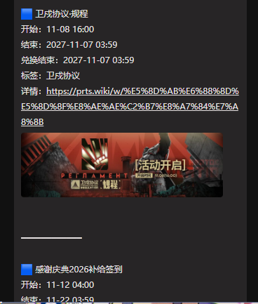
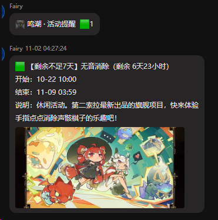
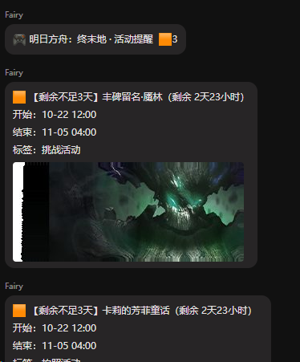
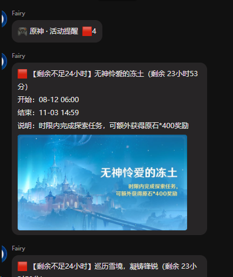
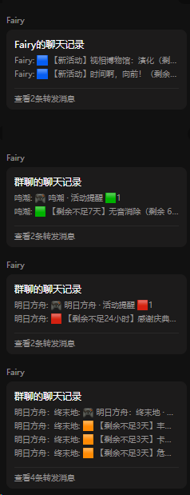
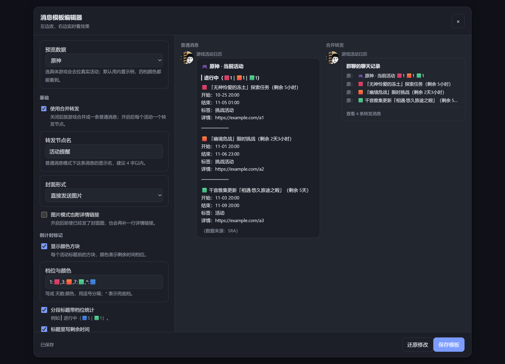

<p align="center">
  
</p>

# 游戏活动日历（astrbot_plugin_game_event_due）

> 🐟 **本插件由 大肥鱼 完成。灵感来源[AUTO-MAS](https://github.com/AUTO-MAS-Project/AUTO-MAS) 的主页活动显示**

> **哦，我的老天——你还在为这些事发愁吗？**
>
> 活动硬拖到最后一天，奖励没拿全；忘了截止时间，白白错过；新活动都开一星期了，
> 你还是从别人嘴里听说的。
>
> 那么好，本插件提供**多游戏活动订阅与到期提醒**：订阅你在玩的游戏，活动一开、
> 剩余 7 天 / 3 天 / 24 小时，它都会准时来敲你喵。
>
> 不过丑话说在前头喵：**我们只保证「通知到位」，不保证「你不会拖到最后一天」。**
> 那部分只能靠你自己了喵。
>
> 推荐启用转发消息模式，除非你不介意雷霆大刷屏

聚合多款游戏的限时活动起止时间，按会话（群聊 / 私聊）订阅推送，支持：

- **新活动提醒** —— 插件第一次发现某个活动时推送一次；
- **倒计时提醒** —— 活动结束前剩余 7 天 / 3 天 / 24 小时各提醒一次（档位可改）；
- **按会话订阅** —— 不同群、不同私聊各自订阅自己关心的游戏；
- **关键词过滤** —— 黑白名单排除或只保留关心的活动；
- **封面直接发图** —— 自动压缩后把活动封面一起推给你；
- **剩余时间标记** —— 每个活动标题前带方块标记（🟥 不足 24 小时 / 🟧 3 天 / 🟩 7 天 / 🟦 更久），
  消息标题里还会统计各档位数量，一眼看出哪个马上要结束；
- **合并转发** —— 可选把每个游戏的一轮推送折叠成一条转发消息，游戏里的每个活动各自成一个节点，
  多个游戏**不会**挤进同一条转发里，既不刷屏又能逐条展开；
- **紧急私聊提醒** —— 快结束时主动私聊催指定的人（进档后按间隔重复，直到对方回一句 `/我已知晓`），
  带夜间静默、每日上限与一键停止；
- **可视化模板编辑器** —— 在网页里按 QQ 实际样子调推送排版，左边改、右边实时预览，
  保存即生效，不用再手改配置里的格式项；
- **管理页** —— 在 AstrBot 后台网页里集中查看和编辑所有订阅。

## 效果展示

活动标题按剩余时间自动标色，标题里直接写「剩余 X」，快结束的排在前面。下面是实际推送的样子：

**剩余 7 天以上 —— 蓝色**



**剩余 7 天内 —— 绿色**



**剩余 3 天内 —— 橙色**



**剩余 24 小时内 —— 红色**



**合并转发**：多个游戏同时提醒时，每个游戏一条转发，游戏里的活动各自成一个节点：



**可视化模板编辑器**：在网页里按 QQ 的样子调模板，左边改参数、右边两栏实时预览普通消息与合并转发：



详见 [消息模板编辑器](#消息模板编辑器)。

## 支持的游戏

| 数据源 | 游戏 | 说明 |
| --- | --- | --- |
| [SRA 公共 API](https://starrailassistant.top/reference/public-api/) | 崩坏：星穹铁道、原神、绝区零、鸣潮、异环、蔚蓝档案（国服 / 国际服 / 日服）、明日方舟、明日方舟：终末地、星塔旅人、无限暖暖、少女前线2：追放、战双帕弥什、卡厄斯梦境（国际服）、棕色尘埃2、NIKKE（国际服）、火影忍者 | 无需认证，返回活动名、描述、开始时间、结束时间与封面 |
| [AKEData](https://www.akedata.wiki/) | 明日方舟：终末地 | 官方配置表，含活动与寻访卡池；站点在境内，首次拉取约 12 MB |
| [PRTS](https://prts.wiki/) | 明日方舟 | Semantic MediaWiki 查询，含活动分类与兑换结束时间；站点有限流 |

### 游戏代号速查

订阅、配置、别名都用得上（`/活动游戏` 也会列出这些）：

| 代号 | 游戏 | 内置别名 |
| --- | --- | --- |
| `sr` | 崩坏：星穹铁道 | 崩铁、星铁、星穹铁道、starrail、hsr |
| `ys` | 原神 | genshin、genshinimpact |
| `zzz` | 绝区零 | zenless、zenlesszonezero |
| `ww` | 鸣潮 | wuwa、wutheringwaves |
| `nte` | 异环 | neverness、nevernesstoeverness |
| `ba-cn` | 蔚蓝档案（国服） | 蔚蓝档案、碧蓝档案、ba、蔚蓝国服 |
| `ba-global` | 蔚蓝档案（国际服） | 蔚蓝国际服、ba国际服 |
| `ba-jp` | 蔚蓝档案（日服） | 蔚蓝日服、ba日服 |
| `endfield` | 明日方舟：终末地 | 终末地、zmd |
| `arknights` | 明日方舟 | 舟、方舟、ak |
| `xtlr` | 星塔旅人 | 星塔 |
| `infinitynikki` | 无限暖暖 | 暖暖、infinity |
| `gf2` | 少女前线2：追放 | 少前2、少前、少女前线 |
| `pgr` | 战双帕弥什 | 战双、punishinggrayraven |
| `czn` | 卡厄斯梦境（国际服） | 卡厄斯、卡厄斯梦境 |
| `bd2` | 棕色尘埃2 | 棕尘、棕色尘埃、browndust2 |
| `nikke` | NIKKE（国际服） | 妮姬、胜利女神 |
| `hyrz` | 火影忍者 | 火影、naruto |

> 想把显示名改成自己的叫法：插件配置 → 消息格式 → **自定义游戏显示名称**，
> 每行一条 `代号=名字`，例如 `sr=星铁`、`arknights=舟游`、`endfield=终末地`。
> 左边写代号、完整名称或内置别名都能命中（不区分大小写），留空就用原始名称。

共 **18 款游戏**。三个数据源都可以在配置里单独开关。

> 后 8 款（星塔旅人、无限暖暖、少女前线2、战双、卡厄斯梦境、棕色尘埃2、NIKKE、火影忍者）
> 只有 SRA 一个来源，数据由社区维护，详见 [需要注意的几款游戏](#需要注意的几款游戏)。

> 明日方舟与终末地在 SRA 里也有数据，可以在「数据源设置」里切换用哪个：
> `arknights_source`（`prts` / `sra`）、`endfield_source`（`akedata` / `sra`）。
> 两个来源的活动 ID 不同，**切换后这款游戏的活动会被当成全新活动再推送一次**。

## 安装

将本目录放入 AstrBot 的 `data/plugins/`，在插件管理页重载即可。依赖只有 `httpx`
（AstrBot 自带）。

> 服务器访问 SRA（`starrailassistant.top`，香港）不稳定时，在配置里填代理地址即可。
> PRTS 与 AKEData 的服务器都在国内，默认**直连**、不经过代理——走代理反而会绕远，
> AKEData 套了 Cloudflare，从境外出口访问还可能直接返回 404。要调整这个名单，
> 改配置里的「直连域名」。

## 指令

| 指令 | 别名 | 说明 |
| --- | --- | --- |
| `/活动订阅 <游戏...>` | `game_sub` | 订阅游戏，成功后立即推送一次当前活动概览 |
| `/活动退订 <游戏...>` | `game_unsub` | 退订指定游戏；`/活动退订 全部` 清空本会话订阅 |
| `/活动列表` | `game_list` | 查看本会话的订阅、档位与过滤设置 |
| `/活动查询 [游戏...]` | `game_query`、`活动` | 查看当前进行中与即将开始的活动 |
| `/活动游戏` | `game_games` | 列出支持的全部游戏与代号 |
| `/活动过滤 黑名单 <关键词...>` | `game_filter` | 命中关键词的活动不推送 |
| `/活动过滤 白名单 <关键词...>` | | 填写后只推送命中关键词的活动 |
| `/活动过滤 清空` | | 清空全部关键词 |
| `/活动封面 图片\|链接\|关闭\|默认` | `game_cover` | 切换本会话的封面形式，默认跟随全局配置 |
| `/活动开关 开启\|关闭` | `game_toggle` | 开关本会话的全部活动推送 |
| `/活动阈值 7 3 1` | `game_threshold` | 自定义倒计时档位 |
| `/活动阈值 关闭` | | 关闭倒计时提醒，只保留新活动提醒 |
| `/活动阈值 默认` | | 恢复全局默认档位 |
| `/活动状态` | `game_status` | 管理员：数据源、上轮轮询结果与异常 |
| `/活动刷新` | `game_refresh` | 管理员：立即执行一轮检查 |
| `/活动私人提醒 @某人` | `game_dm` | 管理员：把某人加入紧急私聊提醒 |
| `/活动私人提醒 移除 @某人` | | 管理员：把某人移出紧急提醒 |
| `/活动私人提醒 列表` | | 查看当前的紧急提醒目标与正在被催的活动 |
| `/活动私人提醒 停止` | | 停止对自己的紧急提醒 |
| `/活动私人提醒 测试` | | 给自己发一条测试私聊，验证主动私聊是否可用 |
| `/我已知晓 [活动名]` | `game_ack`、`已知晓` | 停止对自己的紧急提醒；跟活动名可以只停那一个 |

游戏名支持中文全名、简称与代号，例如 `崩铁`、`星铁`、`sr`、`原神`、`ys`、`绝区零`、
`zzz`、`鸣潮`、`异环`、`终末地`、`明日方舟`、`方舟`、`蔚蓝档案`、`ba`。
`蔚蓝档案` / `碧蓝档案` 会同时匹配国服、国际服与日服。

关键词匹配的对象是「活动名 + 描述 + 标签」，大小写不敏感。例如终末地的寻访卡池带
`特许寻访` 标签，`/活动过滤 黑名单 寻访` 就能把它们全部排除。

## 提醒机制

### 新活动

插件每轮轮询会拿到一份活动列表。**某个活动第一次出现在某个会话的视野里**时，推送一次
「新活动」。

- 插件启动时并不会对所有活动刷屏 —— 会话在 `/活动订阅` 那一刻已经存在的活动会被标记为
  已知（并随订阅回执的概览一起展示），只有之后再出现的活动才算「新活动」。
- 开始时间超过 `新活动提前预告窗口`（默认 45 天）的活动暂不推送，等进入窗口后再推。
- 每轮每个会话每个游戏最多推送 `max_new_per_cycle`（默认 8）条纯新活动，避免数据源异常时刷屏。
  带倒计时提醒的活动不受这个限制。

### 倒计时

按活动**结束时间**计算剩余时间。进入某个档位时提醒一次，并且只提醒「更紧急」的档位：

- 默认档位 `7,3,1`，`1` 表示剩余不足 24 小时；
- 如果某轮才发现一个只剩 5 小时的活动，只会推一次「剩余不足24小时」，不会把 7 天 / 3 天
  的提醒补发一遍；
- 已经推过的档位不会重复推送；
- 默认只对**已经开始**的活动做倒计时（`remind_only_active`）。未开始的活动只在「新活动」
  时出现一次，避免提前一个月就报「剩余 7 天」；
- 同一个活动在同一轮里同时命中「新活动」和某个档位时，会合并成一条消息，标题形如
  `【新活动 · 剩余不足3天】`。

### 推送形态

默认**主动发送活动封面图片**（`cover_mode = image`）。同一个游戏在同一轮里的多条提醒
默认合并为一条消息，每个活动的文字块后面紧跟它自己的封面图：

```
🎮 崩坏：星穹铁道 · 活动提醒

【新活动】方寸大冒险
开始：09-12 12:00
结束：09-28 03:59（剩余 5天14小时）
[封面图片]

━━━━━━━━━━━━

【剩余不足24小时】超限：狂飙大奖赛
结束：09-28 03:59（剩余 7小时30分）
[封面图片]
```

关于封面的几点行为：

- **相邻活动之间会插入分隔线**（`activity_separator`，默认 `━━━━━━━━━━━━`），一条消息里
  推送多个活动时边界更清楚。紧跟分段标题（`▎进行中（N）`）的第一个活动不加线，否则标题会和
  自己的活动被割开。想改成别的样式或干脆只用空行，改这个配置即可（留空 = 只空行分隔）。
- **先压缩再发送**（`cover_compress`，默认开）。封面来自不同 CDN，单张从 140 KB 到
  1.7 MB 不等。压缩到 720px JPEG 后只剩原体积的 5%~10%，所以「每个活动都带图」才
  真正可行：实测终末地 12 张 1.6 MB → 116 KB，星铁 7 张 6.7 MB → 502 KB。
- **单条消息有总体积上限**（`cover_max_total_mb`，默认 5 MB）。按顺序累加，超出的封面
  **自动降级为 `封面：<链接>` 文本行，不会被丢弃**。开启压缩后通常根本用不到这个上限，
  它只是防止关闭压缩后一条消息发出十几 MB。设为 0 表示不限制。
- **图片发送失败会自动重试一次**：把整条消息降级为「文字 + 封面链接」再发。所以图片源
  不可用或适配器不支持图片时，提醒本身不会丢。
- **图片 / 链接可以按会话切换**：全局配置决定默认值，每个群或私聊可以用
  `/活动封面 图片|链接|关闭|默认` 单独覆盖，管理页里也可以改。
- **明日方舟（PRTS）没有封面图**，数据源只提供活动页链接，因此该游戏推送的是
  `详情：<活动页>`。
- `/活动查询` 也会带上封面图片；WebUI 里的「预览当前活动」则始终是纯文本，图片以链接形式展示。

跨年活动的结束时间会自动补上年份，避免出现 `开始 07-17 / 结束 03-10` 这种歧义。

推送失败的消息**不会**被记为已推送，下一轮会重试，不会丢失。

## 配置

配置分为四组，都在插件管理页里。

### 基础设置

| 配置项 | 默认 | 说明 |
| --- | --- | --- |
| `poll_interval_minutes` | 30 | 轮询间隔（分钟），建议不低于 15 |
| `refresh_on_start` | true | 启动时立即执行一轮检查 |
| `request_timeout_seconds` | 20 | 单次请求超时 |
| `proxy` | 空 | 代理地址，如 `http://127.0.0.1:7890` |
| `direct_hosts` | `prts.wiki, media.prts.wiki, data.akedata.wiki` | 这些域名即使配了代理也直连（含子域名）；清空表示全部走代理 |
| `cache_dir` | 空 | 缓存目录，留空用插件数据目录 |

### 数据源设置

> 这几项和管理页的「数据源」面板是同一份配置：面板保存后会写回这里并立即生效。

| 配置项 | 默认 | 说明 |
| --- | --- | --- |
| `enable_sra` | true | 启用 SRA 公共 API（8 款游戏） |
| `sra_api_base` | `https://starrailassistant.top/api/v1/activity` | 接口地址 |
| `enable_akedata` | true | 启用 AKEData（终末地） |
| `akedata_include_gacha_pools` | true | 把寻访卡池也作为活动推送 |
| `enable_prts` | true | 启用 PRTS（明日方舟） |
| `arknights_source` | `prts` | 明日方舟用哪个数据源：`prts` 或 `sra` |
| `endfield_source` | `akedata` | 终末地用哪个数据源：`akedata` 或 `sra` |
| `prts_min_request_interval_seconds` | 20 | PRTS 请求最小间隔，不建议调低 |
| `prts_past_days` | 7 | 只查询结束时间在此天数之后的活动 |

### 提醒策略

| 配置项 | 默认 | 说明 |
| --- | --- | --- |
| `default_thresholds` | `7,3,1` | 全局默认倒计时档位，留空或填「关闭」关闭 |
| `notify_new_activity` | true | 是否推送新活动 |
| `new_activity_lookahead_days` | 45 | 新活动提前预告窗口，0 表示不限制 |
| `notify_on_subscribe` | true | 订阅成功后立即推送当前活动概览 |
| `max_new_per_cycle` | 8 | 每轮每会话每游戏最多推送的纯新活动数 |
| `remind_only_active` | true | 只对已开始的活动做倒计时提醒 |
| `state_retention_days` | 30 | 提醒状态保留天数 |

### 紧急私聊提醒

| 配置项 | 默认 | 说明 |
| --- | --- | --- |
| `enable` | false | 是否启用紧急私聊提醒 |
| `targets` | 空 | 私聊目标（UMO），格式 `平台:FriendMessage:QQ号`，每行一个；也可以留空，改用 `/活动私人提醒 @某人` 添加 |
| `trigger_days` | 1 | 剩余不足多少天开始催（1 = 不足 24 小时） |
| `repeat_minutes` | 120 | 提醒间隔（分钟），最小 5 分钟 |
| `daily_limit` | 3 | 每个目标的每日提醒上限（默认一天三次就够了），0 表示不限制（不建议） |
| `quiet_hours` | `23-8` | 夜间静默时段，填「关闭」表示不静默 |
| `ack_keywords` | 空 | 确认知晓的关键词，留空用默认词表（我已知晓 / 已知晓 / 我知道了 / 知道了） |
| `games` | 空 | 只对这些游戏代号开启紧急提醒，留空表示跟随当前订阅 |

开启合并转发后，催你的那条转发是「标题节点 + 每个活动一个节点」：标题节点写清一共几个活动、
各游戏分别几个（`🚨 铁:2 | 潮:1 | 原:2`，只有一个游戏也照样显示），点开就是逐条活动详情；
标题节点的名字由 `forward_node_name` 决定。

在群里执行 `/活动私人提醒 测试`、`/活动私人提醒 停止` 或 `/我已知晓` 时，
一切都落到**执行者本人的私聊**：测试消息发到你的私聊，停止也只停你自己——不会把提醒或确认发到群里。

> ⚠️ QQ 对高频私聊非常敏感。**建议保留夜间静默与每日上限**，并在真的被催烦时及时
> 用 `/我已知晓` 或 `/活动私人提醒 停止` 收手；无节制轰炸很容易被平台风控。

### 消息格式

| 配置项 | 默认 | 说明 |
| --- | --- | --- |
| `include_description` | false | 附带活动描述 |
| `activity_separator` | `━━━━━━━━━━━━` | 相邻活动之间的分隔线；留空则只用空行分隔 |
| `cover_mode` | `image` | **全局默认**封面形式：`image` 直接发图片 / `link` 仅链接 / `off` 不带封面；每个会话可单独覆盖 |
| `cover_compress` | true | 压缩封面后再发送（720px JPEG，体积降到约 5%~10%） |
| `cover_max_width` | 720 | 封面压缩后的最大宽度（像素），480 更小、1080 更清晰 |
| `cover_max_total_mb` | 5 | 单条消息封面总体积上限，超出的降级为链接；0 表示不限制 |
| `include_tags` | true | 附带活动标签 |
| `include_extra_times` | true | 附带额外时间点（如兑换结束） |
| `single_message_per_game` | true | 每个游戏每轮合并为一条消息 |
| `use_forward_node` | false | 合并转发：每个游戏一条转发消息，游戏内每个活动各自成一个节点（多个游戏不合并进同一条），失败自动回退普通消息 |
| `urgency_marker` | true | 显示剩余时间方块标记（🟥 / 🟧 / 🟩 / 🟦） |
| `urgency_rules` | `1:🟥,3:🟧,7:🟩,*:🟦` | 标记规则：`天数:标记`，逗号分隔，`*` 为兜底档；标记可写 emoji 或颜色名（红/橙/黄/绿/蓝/紫/黑/白） |
| `headline_remaining` | true | 在活动标题里显示剩余时间，例如「🟥 活动名（剩余 6小时）」 |
| `tier_summary` | true | 在消息标题里统计各档位数量，例如「🎮 星穹铁道 · 活动提醒  🟥1 🟧2」 |
| `sort_by_urgency` | true | 按紧急度排序，最紧急的活动排在最前 |
| `image_mode_detail_link` | false | 图片模式下是否仍附「详情：链接」；默认关闭，带图的活动不再贴链接 |
| `game_aliases` | 空 | 自定义游戏显示名，每行一条 `代号=名字`（如 `sr=星铁`）；支持代号、完整名或内置别名，留空用原名 |
| `use_short_names` | true | 转发消息的节点名、私聊提醒的统计行用游戏简称，避免「明日方舟：终末地」把消息列表挤断 |
| `game_short_names` | 空 | 自定义游戏简称，每行一条 `代号=简称`（如 `sr=铁`）；留空用内置简称（铁/原/绝/潮/环/终/舟/蔚国/蔚际/蔚日） |
| `forward_node_name` | 活动提醒 | 合并转发卡片里每条消息前面显示的名字（也用于紧急私聊提醒的标题节点）；建议 4 个字以内，太长会被消息列表截断 |

## 消息模板编辑器

不想手改一堆格式配置？打开 AstrBot 后台 → 插件页 → 游戏活动日历，点右上角 **「消息模板」**，
会弹出按 QQ 实际排版还原的编辑器：

| 区域 | 说明 |
| --- | --- |
| 左上「预览数据」 | 选「示例活动（离线）」用内置样例，不联网、四档颜色都能看到；选具体游戏则拉真实活动 |
| 左栏 | 参数分组：基础 / 倒计时标记 / 正文内容 / 游戏显示名 |
| 右栏「普通消息」 | 不开合并转发时推送长什么样 |
| 右栏「合并转发」 | 开合并转发时的样子：卡片标题、节点名、每行缩略都和真机一致 |

改任何参数，右栏都会在 300ms 后自动重绘，头像用插件 logo、发送者名字固定「游戏活动日历」。
确认后点 **「保存模板」**：直接写进插件配置的 `message_format` 分组并立刻重新加载，下一条推送
就是新样式 —— 不用重载插件；**「还原修改」** 只丢弃本次未保存的改动，不影响已保存的配置。

### 能调什么

| 控件 | 配置键 | 作用 |
| --- | --- | --- |
| 使用合并转发 | `use_forward_node` | 每个游戏一条转发消息，活动各自成一个节点；关掉则合并成普通消息 |
| 转发节点名 | `forward_node_name` | 转发卡片里每条消息前面的名字，建议 4 字以内 |
| 使用简称 | `use_short_names` | 节点名、私聊统计行用简称，避免长游戏名挤断消息列表 |
| 游戏简称 | `game_short_names` | 每行一条 `代号=简称`，如 `sr=铁`；留空用内置简称 |
| 游戏别名 | `game_aliases` | 每行一条 `代号=名字`，改的是「原神」这类显示名 |
| 显示颜色方块 | `urgency_marker` | 活动标题前的 🟥 / 🟧 / 🟩 / 🟦 档位方块 |
| 档位与颜色 | `urgency_rules` | `天数:颜色` 逗号分隔，`*` 兜底，例如 `1:🟥,3:🟧,7:🟩,*:🟦` |
| 分段标题带档位统计 | `tier_summary` | 标题里统计各档数量，如「▎进行中（🟦5 \| 🟩1）」 |
| 标题里写剩余时间 | `headline_remaining` | 活动名后跟「剩余 3天4小时」，免得一眼看不到 |
| 按紧急度排序 | `sort_by_urgency` | 最快结束的排最前 |
| 封面形式 | `cover_mode` | 直接发图片 / 只发链接 / 不发封面 |
| 图片模式也附详情链接 | `image_mode_detail_link` | 默认关，带图时不再重复贴链接 |
| 包含活动说明 | `include_description` | 附带活动描述，过长会截断 |
| 包含标签 | `include_tags` | 附带活动标签 |
| 包含兑换结束时间 | `include_extra_times` | 附带兑换截止等额外时间点 |
| 活动分隔线 | `activity_separator` | 相邻活动之间的分隔线，留空只用空行 |

### 几个常见改法

- 节点名太长挤断消息列表：把简称改成更短的（`sr=铁`），右栏的转发节点名会立刻跟着变；
- 详情链接一长串很丑：封面形式选「直接发送图片」，再关掉「图片模式也附详情链接」；
- 几个游戏同时结束刷屏：打开「使用合并转发」，一个游戏一条，点开才看细节。

> 编辑器只覆盖观感相关的格式项。封面压缩参数、黑白名单、档位天数、推送开关这些
> 仍在左侧会话面板和插件配置里改；手改配置也行，键名对照见上面的「消息格式」表。

## 管理页

插件注册了 `/astrbot_plugin_game_event_due/*` 接口，配套页面位于 `pages/activity/`，
可在 AstrBot 后台的插件页里打开。可以：

- 查看每个会话订阅了哪些游戏、档位、封面形式与过滤设置；
- 直接编辑游戏勾选、开关、档位、封面形式、黑白名单（群名会自动从适配器获取）；
- 预览某个游戏的当前活动；
- 一键执行一轮检查；
- 用「消息模板」可视化编辑器改推送长什么样（见上一节）；
- 用「数据源」面板改数据源开关、明日方舟 / 终末地用哪个源、代理与直连域名，
  保存后立即生效（会重建 HTTP 客户端并清空图片缓存），不用重启 AstrBot。

## 数据源注意事项

### SRA 公共 API

官方文档本身支持 18 款游戏（含明日方舟与终末地），返回结构统一、稳定，是主力数据源。
请求带 ETag，未变化时返回 304，不会重复下载。

#### 需要注意的几款游戏

后 8 款游戏的数据是社区志愿者维护的，质量参差，订阅前先知道这几点：

- **没有封面**：星塔旅人、战双帕弥什、棕色尘埃2、火影忍者的活动**全都没有封面**，
  少女前线2 与卡厄斯梦境只有部分有。封面模式选「图片」时，这几款只会显示文字与详情链接，
  不会报错，但也就没有配图了；想省流量可以把封面模式调成「链接」。
- **时间是近似值**：SRA 统一按北京时间（UTC+8）输出、不带时区标记。
  NIKKE、棕色尘埃2、卡厄斯梦境是境外服，官方公告里用的是本地时区或 UTC，
  如果发现某条结束时间差了 8 小时，那是数据源头的问题，不是插件算错。
- **卡池会被当成活动**：卡厄斯梦境、棕色尘埃2、NIKKE 的活动列表里混着「限定营救概率提升」
  「Pick Up 活动任务」「赛季通行证」这类条目，一期版本可能有七八条，容易刷屏。
  不想看就用 `/活动过滤 黑名单 概率提升 通行证 Pick up` 挡掉。
- **活动条数少不代表没活动**：无限暖暖、少女前线2 在 SRA 里只有 2 条左右，
  常驻玩法与商店不会出现在列表里，只推限时活动。

### 同一款游戏的两个来源

明日方舟与终末地同时被 SRA 和 PRTS / AKEData 覆盖，可以二选一：

| 游戏 | 默认 | 可选 | 差别 |
| --- | --- | --- | --- |
| 明日方舟 | PRTS | SRA | PRTS 带活动标签与**兑换结束时间**，但站点有 WAF、默认 20 秒一次；SRA 更新更快没有限制，代价是没有兑换结束时间与标签 |
| 终末地 | AKEData | SRA | AKEData 是游戏内配置表，含寻访卡池、封面最全，首次约 12 MB；SRA 轻量、几 KB，但卡池信息不全 |

切换方式：插件配置 → 数据源设置 → `arknights_source` / `endfield_source`；`/活动状态`
里也会显示当前用的是哪个来源。**两个来源的活动 ID 不同，切换后这款游戏的活动会被当成
全新活动再推送一次**。指定的来源被关掉时（比如关了 PRTS），会自动回退到剩下的那个。

### AKEData（终末地）

数据来自游戏内配置表。其中 `I18nTextTable_CN.json` 约 **11.7 MB**、`CharacterTable.json`
约 10 MB，因此本插件：

- 只在**游戏大版本**变化时重新下载表数据（hotfix 版本号变化不触发）；
- 文本表在同一大版本内共享缓存，避免每次 hotfix 重复下载 11.7 MB；
- **不下载** `CharacterTable.json`（只影响卡池 UP 角色的名字展示，卡池时间与名称不受影响）；
- 解析后只保留精简的活动列表落盘，旧的版本缓存会自动清理。

没有结束时间的常驻内容（如干员指引）不会被推送。

### PRTS（明日方舟）

PRTS 部署了较严格的 WAF：连续请求会被临时返回 403。本插件通过以下方式规避：

- 使用 Semantic MediaWiki 的 `action=ask` 接口**一次查询**取回全部活动及其开始 / 结束 /
  兑换结束时间，不逐页抓取；
- 内置最小请求间隔（默认 20 秒）；
- ETag 之外的磁盘缓存回退 —— 请求失败时使用上次成功结果，并在日志与 `/活动状态` 中提示；
- 默认 30 分钟一轮，PRTS 每轮通常只需 1 次请求。

抓取时会自动丢弃 PRTS 的维护类分类（如「使用Tabber扩展的标签页」「正在编辑的页面」），
只保留真实的活动分类。

## 常见问题

**Q：后台「插件配置」里找不到新功能（颜色标记 / 合并转发 / 紧急私聊提醒）？**
这些属于插件**全局配置**，位置在 AstrBot 后台的「配置 → 插件配置 → 游戏活动日历」；
插件自带的那个管理页只管**单个会话**的订阅、档位、关键词与封面形式，并不包含这几个新功能。
如果配置页里还是旧选项：先在插件管理里**重载插件**（或重启 AstrBot）再刷新页面——
配置表单是按插件启动时读取的 `_conf_schema.json` 生成的。

**Q：为什么有的消息是合并转发，有的不是？**
合并转发取决于平台能力：目前只有 aiocqhttp 系（NapCat / Lagrange 等）支持 QQ 合并转发；
平台不支持或发送失败时会自动回退成普通消息，日志里会留下
「合并转发发送失败，回退为普通消息」的原因。另外两类消息的形态不同：
定时提醒是**每个游戏一条转发、游戏里的每个活动各自成一个节点**（多个游戏绝不会挤进同一条转发），
而 `/活动查询`、订阅概览这类一次性消息是**整条折叠成一个节点**。

**Q：那几种颜色的方块是什么意思？**
按「距离结束还剩多久」分档：🟥 不足 24 小时、🟧 不足 3 天、🟩 不足 7 天、🟦 更久。
档位与颜色都可以在配置里的 `urgency_rules` 改（例如改成 `2:红,5:橙,*:蓝`），也可以整个关掉。
消息标题里的 `🟥1 🟧2` 是这条消息里各档位的活动数量。

**Q：紧急私聊提醒为什么突然不催了？**
按顺序检查：① 是不是到了夜间静默时段（默认 23:00–08:00）；② 是不是达到了每日上限（默认 3 次，间隔 2 小时）；
③ 是不是有人回过 `/我已知晓`（确认后就不再提醒该活动）；④ 活动是否已经结束。
用 `/活动私人提醒 列表` 可以看到当前目标与还在催的活动。

**Q：所有指令都完全没反应，日志里也看不到任何报错？**
优先检查 AstrBot 后台的 **配置 → 插件配置 → 可用插件**（配置键 `plugin_set`）。

这一项是「哪些插件允许响应」的白名单，AstrBot 在**唤醒检查**阶段就按它过滤处理器：

- 如果它是默认的 `["*"]`，表示所有插件都参与，不会有这个问题；
- 如果它是一份**显式勾选的插件列表**，那么**不在列表里的插件，其指令会静默失效**——
  消息永远不会被识别成指令，因此既没有回复也没有报错。

插件改名、或从旧版本迁移后，列表里可能仍留着**旧插件名**，需要手动换成新名字。
这类问题与插件本身无关：日志里会看到 `Loading plugin ...` 和插件的初始化输出，
一切正常，只是指令不触发。

**Q：为什么订阅之后没有立刻收到消息？**
订阅成功会立即推送一次当前活动概览。如果数据源暂时不可用，会提示稍后重试，并在下一轮
轮询时正常推送。

**Q：为什么「混沌回忆」「虚构叙事」这类活动一直在提醒？**
这类周期玩法每期都会换名字和档期，因此每期都算新活动。可以用
`/活动过滤 黑名单 混沌回忆 虚构叙事 末日幻影` 排除，或在管理页里批量设置。

**Q：为什么终末地的卡池也被推了？**
卡池默认作为活动推送（带 `特许寻访` 等标签）。用 `/活动过滤 黑名单 寻访` 即可排除，
或在配置里关闭 `akedata_include_gacha_pools`。

**Q：改档位后会不会把之前的提醒补发？**
不会。档位只在会话收到提醒时按「更紧急」方向推进，下调档位不会导致历史提醒补发。

**Q：想加别的游戏怎么办？**
在 `sources/` 下新增一个实现 `ActivitySource` 的数据源，并在 `main.py` 的
`_build_sources()` 中注册即可，其余流程（订阅、过滤、提醒、投递、管理页）会自动生效。

## 开发

```bash
pytest -q
ruff check --select F,E9,B main.py activity_webui.py sources services tests
python -m compileall -q main.py activity_webui.py sources services tests
python -m json.tool _conf_schema.json
```

测试不依赖 AstrBot 运行时：`sources/` 与 `services/` 中除发送层外的模块均为纯逻辑。

## 致谢

- [AUTO-MAS](https://github.com/AUTO-MAS-Project/AUTO-MAS) : 自动化脚本类软件的管理工具，助我更好地猛嗦铃兰、洛茜、希儿、芙宁娜、诺姆、尤诺、安魂曲玉足
- [StarRailAssistant](https://github.com/Shasnow/StarRailAssistant) : 崩坏星穹铁道自动化助手，提供了一套免费、无需注册、无需 API 密钥的公开 REST API，助我更好地猛嗦希儿、芙宁娜、诺姆、尤诺、安魂曲玉足
- [AKEData](https://github.com/nagiyume/akedatabase) : 《明日方舟：终末地》非官方数据查询与研究站，助我更好地猛嗦洛茜玉足
- [PRTS](https://prts.wiki/) : 明日方舟爱好者搭建并协作编写的非营利wiki类资料站点，助我更好地猛嗦铃兰玉足
- [AstrBot](https://github.com/AstrBotDevs/AstrBot): 可靠的聊天机器人，助我更好地猛嗦玉足
